# Reto básico 1: exploración y calidad de datos (EDA)

**III Malackathon 2026 · Mercedes-Benz Group Services Madrid · "Clustering the Star"**

> Documento de referencia del reto 1. Todas las cifras, tablas y figuras salen del script reproducible
> [`eda/eda_reto1.py`](eda_reto1.py). La salida completa de tablas está en
> [`eda/outputs/resultados.md`](outputs/resultados.md) y las figuras en [`eda/figures/`](figures/).

---

## Índice

0. [Resumen ejecutivo](#0-resumen-ejecutivo)
1. [Objetivo, alcance y reproducibilidad](#1-objetivo-alcance-y-reproducibilidad)
2. [Estructura del dataset](#2-estructura-del-dataset)
3. [Granularidad: qué es cada fila](#3-granularidad-qué-es-cada-fila)
4. [Identificadores y metadatos: exclusión justificada](#4-identificadores-y-metadatos-exclusión-justificada)
5. [Estadísticos descriptivos](#5-estadísticos-descriptivos)
6. [Análisis de valores nulos](#6-análisis-de-valores-nulos)
7. [Inconsistencias y anomalías](#7-inconsistencias-y-anomalías)
8. [Distribuciones de variables clave](#8-distribuciones-de-variables-clave)
9. [Relaciones entre variables](#9-relaciones-entre-variables)
10. [Tratamiento de nulos (decisión del equipo, aplicado)](#10-tratamiento-de-nulos-decisión-del-equipo-aplicado)
11. [Hallazgos y conclusiones](#11-hallazgos-y-conclusiones)
12. [Implicaciones para el reto 2 (feature engineering)](#12-implicaciones-para-el-reto-2-feature-engineering)
13. [Anexo: ficheros generados](#13-anexo-ficheros-generados)

---

## 0. Resumen ejecutivo

| | |
|---|---|
| **Volumen** | 302.850 filas × 39 columnas · **173.456 clientes** · 244.519 vehículos · 2 mercados (Suiza 66 %, Austria 34 %) |
| **Grano** | Una fila = **una relación cliente–vehículo** (no un cliente). El clustering debe hacerse sobre una vista **agregada por cliente**. |
| **Cliente tipo** | Hombre (65 %; 17 % sin género inferido), de 45 a 65+ años (61 % tiene ≥ 45), particular (B2C 99,4 %), con **un único vehículo conectado** (81 %), cliente desde hace unos 3 años (mediana 36 meses), **sin leasing** (71 %) y que acepta todos los canales de comunicación (81 %). |
| **Vehículo tipo** | SUV o berlina compacta/media (GLC, C, A, B/GLA/GLB), 4MATIC (59 %), de unos 4,7 años, de combustión. La electrificación crece rápido: los BEV pasan del 2,5 % de las matriculaciones de 2019 al 37,5 % de las de 2026. |
| **Problemas de calidad** | (1) Telemetría ausente en el **52 %** de filas (ausencia estructural); (2) `engine_concept` y `fuel_type` nulos en el 44 % y el 59 %; (3) **columnas redundantes** que son derivadas exactas de otras; (4) pico artificial de `months_as_mb_customer` = 36; (5) taxonomía de `model_class` solapada y series nuevas sin clase; (6) medianas y modas de telemetría discretizadas con dos esquemas de bins; (7) valores físicamente imposibles (velocidad media < 1 km/h, contadores a 0 con métricas informadas); (8) 833 "clientes" con más de 20 relaciones (posibles concesionarios o flotas); (9) CP con formato erróneo que además se repiten entre países. |
| **Resolución** | Se aplican las reglas del equipo ([`Descripcion_uso_de_datos`](../Descripcion_uso_de_datos)): se eliminan A, B, C y H (índice, IDs y `model_class`); la telemetría pasa a 0 (velocidad: moda o mediana de su serie); la motorización se rellena con la moda; el CP nulo se sustituye por uno aleatorio y la socio-demografía por el valor del CP (con respaldo región/país); el género nulo pasa a `unknown`. Resultado: **0 nulos**, con flags de imputación. La fecha de matriculación (M) queda **pendiente**. El EDA advierte de tres efectos que conviene revisar: el sesgo de la motorización por moda, los CP inventados y un posible clúster artificial "sin telemetría" (§10.3–10.4). |

---

## 1. Objetivo, alcance y reproducibilidad

Según [`Especificaciones_proyecto.md`](../Especificaciones_proyecto.md), el reto 1 pide un EDA completo con:

- estadísticos descriptivos de las variables principales (§5);
- análisis de nulos e inconsistencias con una propuesta de tratamiento justificada (§6, §7, §10);
- distribuciones de las variables clave (§8);
- identificación y exclusión justificada de identificadores y metadatos (§4);
- un breve resumen de hallazgos: principales características de los clientes y problemas de calidad resueltos (§0, §11).

El fin último del proyecto es segmentar clientes con K-Means para marketing personalizado (ofertas de vehículo,
planes de mantenimiento, fidelización y comunicaciones). Por eso el EDA se hace pensando en qué información
servirá luego para segmentar.

El **tratamiento de nulos** y la eliminación de columnas siguen la decisión del equipo recogida en
[`Descripcion_uso_de_datos`](../Descripcion_uso_de_datos) (§10). El EDA documenta su impacto y señala los puntos
que conviene revisar.

**Reproducir:**

```bash
python -m venv .venv
.venv/Scripts/python -m pip install -r requirements.txt
.venv/Scripts/python eda/eda_reto1.py
```

**Fecha de referencia:** la matriculación más reciente del fichero es del 2026-10-02, así que se toma el
**2026-10-15** como fecha de corte para calcular antigüedades.

---

## 2. Estructura del dataset

### 2.1 Dimensiones e integridad

| Métrica | Valor |
|---|---|
| Filas | 302.850 |
| Columnas | 39 (38 del diccionario + `Unnamed: 0`) |
| Clientes únicos (`client_id`) | 173.456 |
| Vehículos únicos (`vehicle_id`) | 244.519 |
| Filas duplicadas completas | **0** |
| Pares (`client_id`, `vehicle_id`) duplicados | **0**: el par es la clave primaria |
| `Unnamed: 0` | Igual a 0…n-1: es un índice de pandas exportado al CSV |
| Codificación | UTF-8 correcta (p. ej. `E-Class Coupé/Cabriolet`) |

### 2.2 Bloques temáticos

Las 38 columnas útiles se agrupan en seis bloques. Esta agrupación ayuda a razonar tanto los nulos como las features:

| Bloque | Columnas | Nivel real del dato |
|---|---|---|
| **Identificadores** | `client_id`, `vehicle_id`, `zipcode` | clave |
| **Perfil del cliente** | `age_range`, `gender_derived`, `country_code` | cliente |
| **Relación con la marca** | `months_as_mb_customer`, `currently_connected_vehicles`, `finance_leasing_status`, 3 × `consent_*` | cliente |
| **Vehículo** | `model_series`, `vehicle_type`, `model_class`, `product_group`, `engine_concept`, `fuel_type`, `date_of_first_registration` | vehículo |
| **Relación cliente–vehículo** | `role`, `role_type`, `is_current_vehicle`, `workshop_visits_warranty_goodwill` | relación |
| **Socio-demografía (por CP)** | `purchasing_power_per_inhabitant_eur`, `purchasing_power_per_household_eur`, `purchasing_power_millions_eur`, `population`, `number_of_households` | zona (CP) |
| **Telemetría / uso** | `trip_distance_*` (4), `speed_*` (4), `operating_hours_total`, `fuel_consumption_average` | relación |

### 2.3 Tipos, cardinalidad y nulos

| Columna | Tipo | Únicos | % nulos | Comentario |
|---|---|---:|---:|---|
| `client_id` | str (hash 64 hex) | 173.456 | 0,00 | identificador |
| `vehicle_id` | str (hash 64 hex) | 244.519 | 0,00 | identificador |
| `age_range` | str (ordinal) | 6 | 0,00 | `<25` … `65+` |
| `gender_derived` | str | 2 | 11,20 | inferido, no declarado |
| `model_series` | str (código) | 88 | 0,00 | se lee como texto: es un código, no un número |
| `vehicle_type` | str | 1.436 | 0,30 | texto libre + códigos técnicos de furgoneta |
| `model_class` | str | 42 | 1,11 | taxonomía solapada |
| `product_group` | str | 4 | 0,00 | P / T / G / F |
| `engine_concept` | str | 4 | **44,38** | |
| `country_code` | str | 2 | 0,00 | CH / AT |
| `fuel_type` | str | 7 | **59,02** | valores compuestos (`DIESEL,ELECTRIC`) |
| `date_of_first_registration` | fecha (str) | 5.316 | 1,38 | |
| `is_current_vehicle` | bool | 2 | 0,00 | |
| `role` | str | 5 | 0,00 | |
| `role_type` | str | 2 | 0,00 | |
| `months_as_mb_customer` | float | 121 | 0,00 (4 filas) | |
| `currently_connected_vehicles` | int | 22 | 0,00 | |
| `finance_leasing_status` | str | 4 | 0,00 | |
| `workshop_visits_warranty_goodwill` | int | 36 | 0,00 | |
| `consent_*` (×3) | bool | 2 | 0,00 | |
| `purchasing_power_*` (×3), `population`, `number_of_households` | float | 2.296–5.035 | 6,28–6,30 | |
| `zipcode` | str | 4.610 | 5,33 | se lee como texto para no perder formato |
| `trip_distance_average` / `_median` / `_all_counter` | float | — | 59,4–61,4 | |
| `trip_distance_mode`, `speed_mode` | **str** | 108 / 17 | ≈ 59,5 | listas separadas por comas |
| `operating_hours_total` | float | 80.943 | 57,57 | |
| `fuel_consumption_average` | float | 2.267 | 59,67 | |
| `speed_average` / `_median` / `_all_counter` | float | — | 59,8–60,2 | |

> **Nota de carga:** `zipcode`, `model_series` y las columnas `*_mode` se fuerzan a `str` en `read_csv`.
> Con la inferencia por defecto, `zipcode` sale con tipos mixtos (`DtypeWarning`), porque hay CP como
> `A-2100` o `Ottenbach`.

---

## 3. Granularidad: qué es cada fila

Es el hallazgo estructural más importante del EDA. **El dataset no es una tabla de clientes, sino de
relaciones cliente–vehículo.**

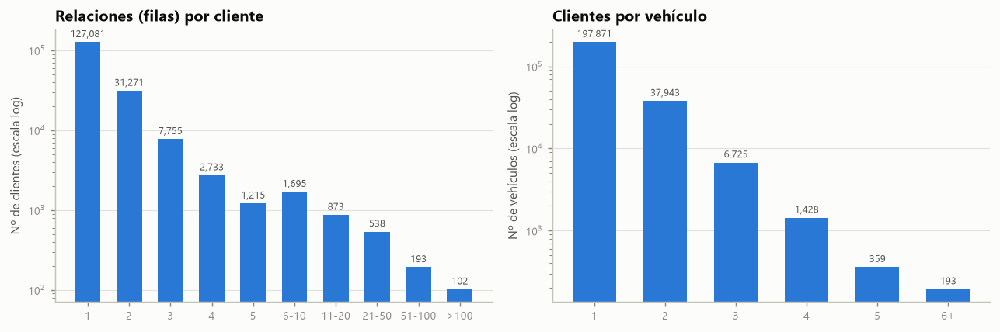

| | filas por cliente | filas por vehículo |
|---|---:|---:|
| media | 1,75 | 1,24 |
| mediana | 1 | 1 |
| p90 | 2 | 2 |
| p99 | 10 | 3 |
| p99,9 | 74 | 5 |
| máx. | **561** | 36 |

- El 73 % de los clientes (127.081) tiene una sola fila; el resto aparece en 2 o más relaciones (vehículos actuales y pasados).
- Un mismo vehículo puede aparecer con varios clientes (propietario, usuario, conductor de empresa, propietario anterior…).

**¿Qué atributos pertenecen a qué entidad?** Para comprobarlo se mide si un atributo cambia dentro del mismo cliente o del mismo vehículo:

| Atributo | % de clientes con más de 1 fila en los que varía | % de vehículos con más de 1 fila en los que varía |
|---|---:|---:|
| `age_range`, `gender_derived`, `country_code`, `months_as_mb_customer`, `currently_connected_vehicles`, `finance_leasing_status`, `consent_*`, `zipcode`, socio-demografía | **0,00** | — |
| `role` | 25,99 | — |
| `role_type` | 1,18 | — |
| `model_series`, `vehicle_type`, `model_class`, `product_group`, `engine_concept`, `fuel_type`, `date_of_first_registration` | — | **0,00** |
| `is_current_vehicle` | — | 63,39 |
| `workshop_visits_warranty_goodwill` | — | 62,79 |
| telemetría (`operating_hours_total`, `trip_distance_average`, `speed_average`) | — | 53–56 |

**Conclusiones:**

1. Los atributos de cliente son **perfectamente consistentes** entre sus filas (0 contradicciones). Se pueden tomar de cualquier fila del cliente.
2. Los atributos de vehículo también lo son.
3. Las visitas al taller y la telemetría **dependen de la relación** (cliente × vehículo × periodo): miden el uso que *ese* cliente hizo de *ese* coche.
4. **Para segmentar clientes hay que agregar a nivel `client_id`** (nº de vehículos, mix de motorización, uso medio, etc.). Si se hiciera clustering sobre filas, un cliente con 561 relaciones pesaría 561 veces más que uno con una sola.

### 3.1 Clientes con un número anómalo de relaciones

| Umbral de filas por cliente | Clientes | Filas que acumulan | % del total de filas |
|---|---:|---:|---:|
| > 10 | 1.706 | 60.530 | 19,99 % |
| > 20 | 833 | 47.677 | 15,74 % |
| > 50 | 295 | 30.754 | 10,15 % |
| > 100 | 102 | 17.283 | 5,71 % |

En los clientes con más de 20 relaciones **solo el 10,4 % de las filas es un vehículo actual** (frente al 68,7 % del resto),
aunque el 88 % figura como `OWNER` y el 92,5 % como B2C. Un particular no "posee" cientos de coches por los que pasa
de forma temporal. Estos perfiles corresponden casi con seguridad a **concesionarios, rent-a-car, flotas o cuentas
de pruebas** registrados con rol de particular. Representan el 0,5 % de los clientes pero el 16 % de las filas.
→ *Tratamiento:* al agregar por cliente su peso pasa a ser 1. Se marcan con `n_relaciones` y se recomienda
excluirlos del clustering B2C o aplicarles un tope (§12).

### 3.2 `role` y `role_type`

| role | B2B | B2C | Total | % actual |
|---|---:|---:|---:|---:|
| OWNER | 0 | 264.418 | 264.418 | 61,1 % |
| USER | 0 | 17.631 | 17.631 | 71,4 % |
| LEGACY | 0 | 11.314 | 11.314 | 46,1 % |
| DRIVER | **5.521** | 0 | 5.521 | 9,9 % |
| TEMP_USER | 0 | 3.966 | 3.966 | 4,3 % |

**`role_type = B2B` ⇔ `role = DRIVER` en el 100 % de los casos**, así que `role_type` es redundante. El B2B es
residual (5.521 filas, el 0,56 % de los clientes) y casi siempre histórico (solo el 9,9 % es actual).

---

## 4. Identificadores y metadatos: exclusión justificada

> **Decisión del equipo** ([`Descripcion_uso_de_datos`](../Descripcion_uso_de_datos), apartado "Quitar ruido"):
> se eliminan las columnas **A, B, C y H**. El documento se refiere a las columnas por su letra al abrir el CSV
> en Excel; la correspondencia completa letra → columna está en la §10.1.

### 4.1 Columnas excluidas (aplicado)

| Letra | Columna | Tipo | Motivo |
|---|---|---|---|
| A | `Unnamed: 0` | metadato | Índice posicional exportado por pandas (0…n-1). No contiene información. |
| B | `client_id` | identificador | Hash SHA-256 sin semántica. **Se conserva en el fichero procesado solo como clave**: sin él no se puede agregar por cliente (§3). No entra como feature. |
| C | `vehicle_id` | identificador | Hash. **Se conserva solo como clave** para contar vehículos por cliente. No entra como feature. |
| H | `model_class` | redundante | Es una **función exacta** de `model_series` (F): 0 series con más de una clase. Además tiene una taxonomía solapada y 3.369 nulos (§7.3). Se queda `model_series`, que no tiene nulos. |

### 4.2 Otras columnas candidatas a exclusión (recomendación para el reto 2, **no aplicada**)

El equipo ha decidido conservar el resto de columnas. Aun así, el análisis encuentra estas redundancias.
Conviene revisarlas al seleccionar features, porque meter en K-Means dos copias de la misma información
duplica su peso en la distancia:

| Letra | Columna | Hallazgo |
|---|---|---|
| AA | `zipcode` | 4.610 códigos nominales: la distancia numérica entre CP no significa nada, y **993 CP existen en AT y en CH a la vez**. Si se codifica, hay que usar el par (país, CP). Además, tras el tratamiento el 5,3 % de los CP es aleatorio (§10.3). |
| G | `vehicle_type` | 1.436 valores de texto libre; 41.059 filas con códigos técnicos de furgoneta (`V 300AVG/L4X2   3200`). Un label encoding de 1.436 enteros crea un orden artificial. Es mejor derivar flags (`AMG`, `4MATIC`). |
| P | `role_type` | B2B ⇔ `role = DRIVER` (100 %): la misma información que O. |
| L | `fuel_type` | Solapada con `engine_concept` (J): tras el tratamiento se deriva directamente de J (§10.2). |
| AM | `purchasing_power_millions_eur` | `= PA_habitante × population / 10⁶` (error relativo máximo de 7·10⁻⁴). Mide el tamaño de la zona, no su riqueza. |
| Y | `purchasing_power_per_household_eur` | `= PA_total × 10⁶ / households` (error máximo de 7·10⁻⁴); ρ = 0,96 con PA/habitante. |
| AL | `number_of_households` | ρ = 0,998 con `population` (el hogar medio es casi constante: 2,24 personas). |
| AC, AI | `trip_distance_mode`, `speed_mode` | Texto con empates (`"1,3,7.5,15,27.5,…"`): marcas de clase de histograma con dos esquemas de bins distintos. |
| AD, AJ | `trip_distance_median`, `speed_median` | Solo 13 y 12 valores (marcas de clase). AJ tiene ρ = 0,85 con `speed_average`. |
| AE, AK | `trip_distance_all_counter`, `speed_all_counter` | Metadatos técnicos (nº de trayectos y de muestras); ρ = 0,80 y 0,93 con `operating_hours_total`. |
| M | `date_of_first_registration` | Como fecha no sirve para K-Means: conviene transformarla en la feature derivada `vehicle_age_years` (ya calculada). |

Además, **no se recomienda usar `gender_derived` como feature de clustering**, aunque sí para describir los
segmentos. El propio diccionario aclara que es un dato inferido y no declarado. Usarlo para segmentar campañas
plantea riesgos de sesgo y de cumplimiento (RGPD / nLPD suiza). Su 17 % de valores desconocidos, además, no es
aleatorio (§6.4).

---

## 5. Estadísticos descriptivos

### 5.1 Variables numéricas (nivel fila)

| Variable | n | media | desv. | mín | p1 | p25 | mediana | p75 | p99 | máx | asimetría |
|---|---:|---:|---:|---:|---:|---:|---:|---:|---:|---:|---:|
| `months_as_mb_customer` | 302.846 | 43,9 | 26,9 | 0 | 0 | 25 | 39 | 60 | 115 | 120 | 0,60 |
| `currently_connected_vehicles` | 302.850 | 2,15 | 3,53 | 0 | 0 | 1 | 1 | 2 | 19 | 21 | 3,46 |
| `workshop_visits_warranty_goodwill` | 302.850 | 1,75 | 2,43 | 0 | 0 | 0 | 1 | 3 | 10 | 44 | 2,19 |
| `vehicle_age_years` *(derivada)* | 298.668 | 5,09 | 3,19 | 0,04 | 0,16 | 2,57 | 4,74 | 7,13 | 14,4 | 39,8 | 0,71 |
| `purchasing_power_per_inhabitant_eur` | 283.763 | 46.481 | 17.295 | 19.702 | 24.292 | 31.518 | 46.166 | 54.211 | 106.184 | 148.354 | 1,74 |
| `population` | 283.836 | 19.665 | 36.803 | **0** | 470 | 3.135 | 7.132 | 17.625 | 220.313 | 220.794 | 3,65 |
| `trip_distance_average` (km) | 116.993 | 16,2 | 10,7 | 1,0 | 2,8 | 10,2 | 14,0 | 19,5 | 49,4 | 300 | 7,62 |
| `operating_hours_total` (h) | 128.492 | 620 | 743 | **0** | 0,09 | 137 | 407 | 856 | 3.394 | 26.842 | 4,06 |
| `fuel_consumption_average` (l/100 km) | 122.125 | 8,56 | 3,26 | 3,0 | 3,6 | 6,6 | 8,1 | 9,7 | 19,0 | 50,0 | 3,60 |
| `speed_average` (km/h) | 120.468 | 48,7 | 14,2 | **0,12** | 2,3 | 41,2 | 49,3 | 57,3 | 80,5 | 220 | −0,30 |
| `trip_distance_all_counter` | 123.020 | 2.352 | 2.768 | 0 | 0 | 518 | 1.593 | 3.321 | 11.405 | 89.078 | 4,94 |
| `speed_all_counter` | 121.691 | 2,5 M | 7,3 M | 0 | 0 | 0,63 M | 1,70 M | 3,38 M | 13,3 M | **1.452 M** | **145,8** |

> Nota: a nivel fila, `currently_connected_vehicles` sale inflado (media 2,15) porque los clientes con muchas
> filas repiten su valor en cada una. A nivel cliente la media es **1,04** (§8.2).

**Outliers según la regla IQR (1,5×):**

| Variable | Límite superior | % outliers |
|---|---:|---:|
| `currently_connected_vehicles` | 3,5 | 11,0 % *(efecto de los clientes con muchas filas)* |
| `population` | 39.360 | 9,8 % *(ciudades grandes: Viena, Zúrich…)* |
| `trip_distance_average` | 33,6 km | 4,7 % |
| `operating_hours_total` | 1.934 h | 4,6 % |
| `fuel_consumption_average` | 14,4 l/100 km | 3,8 % |
| `speed_average` | [17,2; 81,3] km/h | 3,7 % |
| `workshop_visits_warranty_goodwill` | 7,5 | 3,4 % |
| `purchasing_power_per_inhabitant_eur` | 88.249 € | 2,7 % |

Las variables de uso y de tamaño de zona tienen **colas largas a la derecha** (asimetría de 3 a 8). Para K-Means,
que trabaja con distancias euclídeas, hará falta transformación logarítmica o winsorización antes de escalar (§10, §12).

### 5.2 Variables categóricas (nivel fila)

| Variable | Categorías | Moda | % moda | % nulos |
|---|---:|---|---:|---:|
| `age_range` | 6 | 45-54 | 22,5 | 0,0 |
| `gender_derived` | 2 | male | 83,0 (de los conocidos) | 11,2 |
| `country_code` | 2 | CH | 63,7 | 0,0 |
| `product_group` | 4 | P | 84,4 | 0,0 |
| `model_class` | 42 | GLC-Class | 14,8 | 1,1 |
| `engine_concept` | 4 | COMBUSTION | 58,4 (de los conocidos) | 44,4 |
| `fuel_type` | 7 | DIESEL | 28,9 (de los conocidos) | 59,0 |
| `role` | 5 | OWNER | 87,3 | 0,0 |
| `finance_leasing_status` | 4 | never_active | 58,3 | 0,0 |
| `is_current_vehicle` | 2 | True | 59,5 | 0,0 |
| `consent_phone` / `epost` / `post` | 2 | True | 85,6 / 98,3 / 85,1 | 0,0 |

**`product_group`** no coincide con el diccionario, que menciona "V" para furgonetas. El significado de cada código
se deduce cruzándolo con `model_class`:

| Código | Filas | % | Significado (deducido) |
|---|---:|---:|---|
| P | 255.604 | 84,4 | Turismos |
| T | 41.937 | 13,9 | Furgonetas / transporter (V-Class, Vito, Sprinter, Citan, X-Class) |
| G | 4.373 | 1,4 | Clase G |
| F | 936 | 0,3 | smart fortwo/forfour |

---

## 6. Análisis de valores nulos

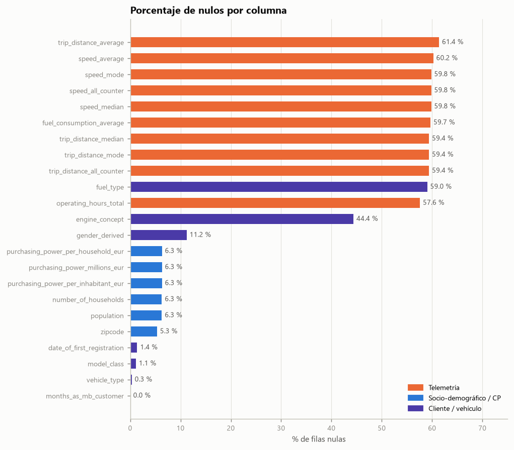

Los nulos no están repartidos al azar. Aparecen **en bloques**, lo que indica que su origen es la fuente de datos,
no errores de captura fila a fila:

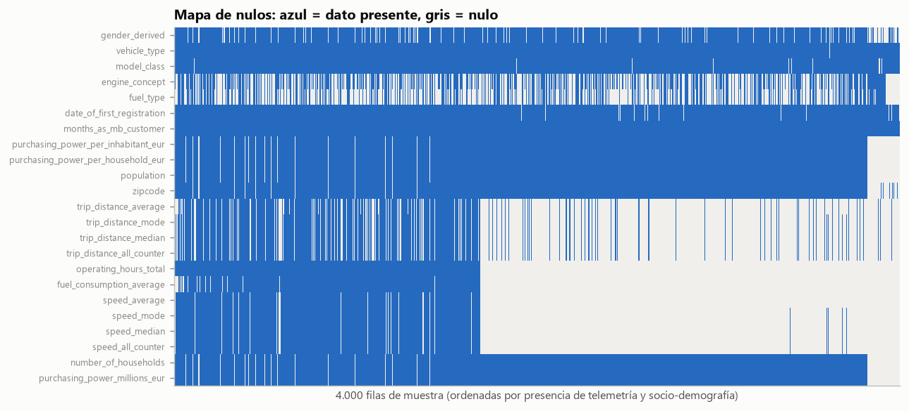

### 6.1 Bloque de telemetría (57–61 % de nulos)

| Patrón de presencia (1 = presente)<br>`td_avg td_mode td_med td_cnt op_h fuel sp_avg sp_mode sp_med sp_cnt` | Filas | % |
|---|---:|---:|
| `0000000000`: sin ninguna telemetría | 156.819 | **51,8** |
| `1111111111`: telemetría completa | 96.680 | 31,9 |
| `1111000000`: solo distancias | 15.587 | 5,1 |
| `0000111111`: horas + consumo + velocidad | 14.151 | 4,7 |
| `0000110000`: solo horas + consumo | 7.009 | 2,3 |
| otros | 12.604 | 4,2 |

**Mecanismo de ausencia (MNAR / estructural).** Que haya telemetría depende de que el vehículo sea conectado
y del tipo de relación:

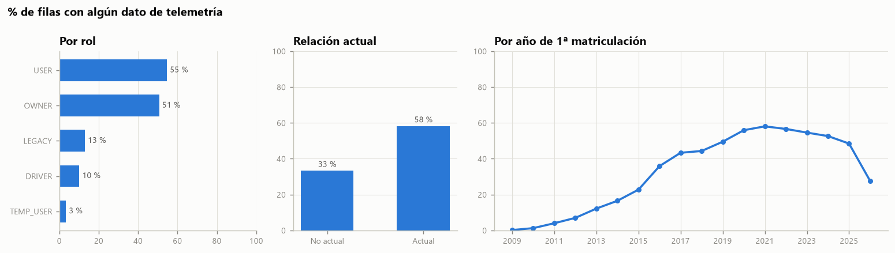

| Grupo | % de filas con alguna telemetría |
|---|---:|
| Relación actual / no actual | 58,3 % / 33,4 % |
| USER / OWNER / LEGACY / DRIVER / TEMP_USER | 54,7 / 50,8 / 13,0 / 10,1 / 3,4 % |
| smart (F) | **0 %** |
| Matriculados en 2009–2012 | ≤ 7 % |
| Matriculados en 2020–2022 | ≈ 56–58 % |
| Matriculados en 2026 | 27,6 % (aún no han acumulado datos) |
| AT / CH | 49,4 % / 47,6 % (el país no influye) |

Interpretación: faltan datos de los coches antiguos (sin unidad telemática), de las relaciones pasadas, de los roles
de uso esporádico y de los coches recién matriculados. **No son nulos aleatorios**: imputarlos con la media
inventaría patrones de conducción y crearía un clúster artificial de "conductor medio".

**Tratamiento (decisión del equipo, §10):** antes de rellenar se crea el flag `has_telemetry`, que conserva la
información de "sin datos". Después:

- distancias, horas y consumo (AB–AG) → **0**;
- `speed_average` (AH) → velocidad moda de su `model_series`; `speed_mode` (AI) → esa misma moda;
  `speed_median` (AJ) → mediana de AH en su serie;
- `speed_all_counter` (AK) → **1**.

Consecuencia: el 0 pasa a significar "sin telemetría", y las velocidades se rellenan con un valor típico de la
serie. La §10.4 mide el impacto.

### 6.2 Motorización: `engine_concept` (44 %) y `fuel_type` (59 %)

| engine_concept \ fuel_type | NA | DIESEL | DIESEL,EL. | ELECTRIC | PETROL | PETROL,EL. | PETROL_PLUS | PETROL_PLUS,EL. |
|---|---:|---:|---:|---:|---:|---:|---:|---:|
| **NA** | **134.390** | 0 | 0 | 0 | 0 | 0 | 0 | 0 |
| COMBUSTION | 43.915 | 28.475 | 0 | 0 | 14.422 | 0 | 11.612 | 0 |
| MILD_HYBRID | 29 | 7.418 | 0 | 0 | 17.946 | 0 | 2.362 | 0 |
| PLUGIN_HYBRID | 411 | 0 | 8.604 | 0 | 0 | 7.371 | 0 | 4.951 |
| ELECTRIC | 0 | 0 | 0 | 20.944 | 0 | 0 | 0 | 0 |

- No hay **ninguna contradicción** entre ambas columnas: cuando las dos están informadas, son coherentes.
- Cuando falta `engine_concept`, falta siempre `fuel_type` (134.390 filas).
- La ausencia depende de la **antigüedad**: el 100 % de nulos en vehículos de 2009–2010 baja al 24–30 % en 2015–2017
  y vuelve a subir en 2018–2022 (~50 %). Depende también del producto: furgonetas 51 %, turismos 43 % y smart 100 %.
- **La información sí se puede recuperar.** Los atributos de vehículo son constantes por vehículo, y la nomenclatura
  comercial de Mercedes-Benz codifica la motorización: `EQ…`/`electric` → BEV; `… e`/`… de`/`Hybrid`/`E Performance` → PHEV;
  `… d`/`CDI`/`BlueTEC` → diésel.

**Tratamiento (decisión del equipo, §10):** `engine_concept` (J) nulo → **moda de la columna (COMBUSTION)**;
`fuel_type` (L) nulo → se saca a partir de J (el `fuel_type` más frecuente para cada `engine_concept`:
COMBUSTION → DIESEL, MILD_HYBRID → PETROL, PLUGIN_HYBRID → DIESEL,ELECTRIC, ELECTRIC → ELECTRIC). Como los 134.390
nulos de J pasan a COMBUSTION, **los 178.745 nulos de L se convierten en DIESEL** (salvo 440 filas).

**Contraste con lo que dicen los datos.** Para medir el efecto de esta decisión se aplicaron, solo como
comprobación, reglas basadas en la nomenclatura y en la serie del vehículo. Su fiabilidad se mide sobre las filas
cuya motorización sí se conoce:

| Regla | Filas evaluables | Acierto sobre datos conocidos |
|---|---:|---:|
| Nombre EQ*/electric → ELECTRIC; e/de/Hybrid → PLUGIN_HYBRID | 37.363 | **99,49 %** |
| Matriculado ≤ 2018 y sin nombre eléctrico → COMBUSTION | 35.741 | **99,18 %** |
| Nombre con `d`/CDI/BlueTEC → DIESEL | 40.280 | **100 %** |
| Turismo térmico sin `d` → PETROL | 58.664 | **100 %** |
| *Moda (COMBUSTION) asignada a cualquier fila* | 168.460 | *58,43 %* |

Según esas reglas, de las 134.390 filas que la moda etiqueta como COMBUSTION: el 51,7 % sí son de combustión,
el **13,5 % son microhíbridos, el 6,9 % PHEV y el 5,9 % eléctricos** (entre ellos 7.114 con nombre `EQ…`), y el
22,0 % queda indeterminado.

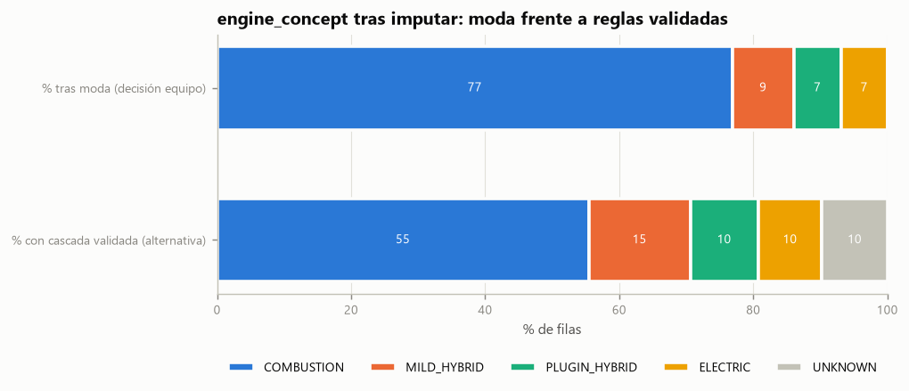

| engine_concept | % original (sobre conocidos) | % tras la moda (aplicado) | % con reglas validadas (alternativa) |
|---|---:|---:|---:|
| COMBUSTION | 58,4 | **76,9** | 55,4 |
| MILD_HYBRID | 16,5 | 9,2 | 15,2 |
| PLUGIN_HYBRID | 12,7 | 7,1 | 10,1 |
| ELECTRIC | 12,4 | 6,9 | 9,5 |
| UNKNOWN | — | — | 9,7 |

| fuel_type | % original (sobre conocidos) | % tras el tratamiento (aplicado) |
|---|---:|---:|
| DIESEL | 28,9 | **70,7** |
| PETROL | 26,1 | 10,7 |
| ELECTRIC | 16,9 | 6,9 |
| PETROL_PLUS | 11,3 | 4,6 |
| híbridos enchufables (3 variantes) | 16,8 | 7,0 |

> ⚠️ **Riesgo para la segmentación.** La moda aumenta la combustión en 18 puntos y deja la electrificación en
> casi la mitad de la real. Además, **71.283 turismos con nomenclatura de gasolina** (regla con un 100 % de acierto)
> quedan etiquetados como DIESEL. Un eje de segmentación por transición energética saldría sesgado. El flag
> `engine_imputed` permite aislar estas filas, pero el equipo debería valorar sustituir la moda por las reglas validadas
> (la cascada de reglas está implementada en `eda/eda_reto1.py`, sección 9.4, para esta comparación).

### 6.3 Socio-demografía y CP (5,3–6,3 %)

| Situación | Filas |
|---|---:|
| Sin CP | 16.135 |
| Con CP pero sin cruce socio-demográfico | 2.879 (concentrados en CP "genéricos": 1000, 3000, 2355, 1104…) |
| Con CP y `population = 0` (sin poder adquisitivo) | 73 (CP de apartados postales o empresas) |
| CP con formato no estándar | 5 → `A-2100`, `CH-6340`, `Ottenbach`, `55605` (5 dígitos) |

- En AT faltan más datos que en CH (8,3 % frente a 5,2 %).
- Cada par (país, CP) tiene un único valor socio-demográfico (0 conflictos). **El cruce es correcto, pero la clave debe ser (país, CP)**, porque 993 CP existen en los dos países.

**Tratamiento (decisión del equipo, §10):**

1. **Limpieza previa:** el CP se normaliza (se quitan los prefijos `A-` y `CH-`; el texto libre y los CP de 5 dígitos pasan a nulo).
2. **`zipcode` (AA) nulo → número aleatorio** entre el CP mínimo y el máximo del país (AT y CH: 1000–9999; semilla fija 42).
3. **X, Y, Z** (PA por habitante, PA por hogar, población) nulos → **media de su CP**. **AL** (hogares) y **AM** (PA total) → **moda de su CP**.

**Limitación detectada.** Los datos socio-demográficos son constantes dentro de cada (país, CP), y **ningún CP tiene
a la vez filas con dato y filas nulas**. Por tanto, "la media del CP" no puede rellenar nunca una fila cuyo CP
original existe: solo funciona con los CP aleatorios que coinciden por casualidad con uno real. Solo el 31,6 %
de los CP generados existe en el dataset y solo el 28,4 % tiene datos socio-demográficos. El resto son códigos
inventados. La variante "media de los que han comprado la misma serie en el mismo CP" da el mismo resultado,
porque el dato es de la zona y no del vehículo.

Para no dejar nulos se añade un **respaldo que no está en el documento**: la mediana de la región (2 primeros dígitos
del CP) y, si no hay región, la del país. Así se rellenan unos 4.580 valores por CP, unos 12.500 por región y unos
1.900–2.000 por país. Los flags `zip_imputed` y `socio_imputed` permiten aislar estas filas.

### 6.4 `gender_derived` (11,2 % de las filas, 17 % de los clientes)

| gender | DRIVER | LEGACY | OWNER | TEMP_USER | USER |
|---|---:|---:|---:|---:|---:|
| NA | 4,1 | 11,9 | 9,2 | **38,1** | **36,2** |
| female | 4,7 | 9,8 | 15,0 | 8,8 | 24,6 |
| male | 91,2 | 78,3 | 75,7 | 53,1 | 39,2 |

| gender (% del rango de edad) | <25 | 25-34 | 35-44 | 45-54 | 55-64 | 65+ |
|---|---:|---:|---:|---:|---:|---:|
| NA | **40,5** | 18,7 | 14,4 | 10,8 | 8,5 | **27,1** |

El desconocido se concentra en los usuarios secundarios y en los extremos de edad. Es un nulo **MAR/MNAR**:
imputarlo con la moda ("male") reforzaría un sesgo. **Tratamiento (decisión del equipo, letra E):** nulos → nueva
categoría `unknown`. Se recomienda usarla solo para describir los segmentos (§4.2).

### 6.5 Otros nulos menores

| Columna (letra) | Nulos | Diagnóstico | Tratamiento (decisión del equipo) |
|---|---:|---|---|
| `model_class` (H) | 3.369 (1,1 %) | **Series nuevas de 2026** sin clase en el maestro: 540 (GLC eléctrico), 244/248 (nuevo GLB), 178 (nuevo CLA), 520 (C eléctrico), 449 (V-Class) | Columna eliminada (ruido); se usa `model_series` (F), que no tiene nulos |
| `vehicle_type` (G) | 922 (0,3 %) | 878 son furgonetas de la serie 420 | `vehicle_type` más frecuente de su `model_series` |
| `date_of_first_registration` (M) | 4.182 (1,4 %) | — | **Pendiente** (el documento dice "M?"). Provisionalmente: mediana de su `model_series` + flag `reg_date_imputed` |
| `months_as_mb_customer` (Q) | 4 filas (2 clientes) | — | → 0.0 |
| N, O, P, R, S, T, U, V, W | 0 | Sin nulos en este extracto | Reglas definidas para datos futuros (False, OWNER, B2C, 1, never_active, moda, False…) |

---

## 7. Inconsistencias y anomalías

### 7.1 Redundancias deterministas

| Relación | Verificación |
|---|---|
| `purchasing_power_millions_eur = PA_habitante × population / 10⁶` | error relativo máximo de 7,4·10⁻⁴ |
| `purchasing_power_per_household_eur = PA_total × 10⁶ / number_of_households` | error relativo máximo de 7,4·10⁻⁴ |
| `population ↔ number_of_households` | ρ = 0,998 (hogar medio de 2,24 personas, p1–p99 [1,85; 2,76]) |
| `role_type = B2B ⇔ role = DRIVER` | 100 % |
| `model_series → model_class` | función exacta (0 conflictos) |
| `currently_connected_vehicles = Σ is_current_vehicle` por cliente | se cumple en el **99,998 %** de los clientes (4 discrepancias) |

Esta última es una buena noticia: confirma que `is_current_vehicle` y `currently_connected_vehicles` son fiables
y coherentes entre sí. **18.048 clientes (10,4 %) no tienen ningún vehículo actual**: son ex-clientes o clientes
"dormidos", un segmento con valor propio para campañas de recuperación (*win-back*).

### 7.2 `months_as_mb_customer`: pico artificial en 36 meses

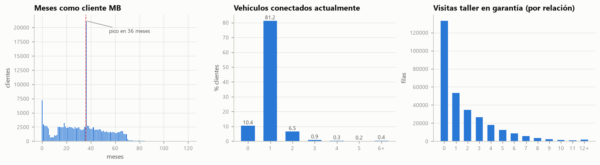

- **21.179 clientes (12,2 %) tienen exactamente 36 meses**, frente a 2.619 con 35 y 2.770 con 37 (unas 8 veces más).
  Ningún proceso de captación natural produce un pico así. Lo más probable es un **valor por defecto o un relleno
  de migración** ("3 años") para clientes cuyo primer vehículo se matriculó sobre todo en 2018–2020.
- 7.254 clientes tienen 0 meses (altas recientes) y el máximo es exactamente **120** (10 años, posible truncado).
- También hay una caída brusca a partir de unos 70 meses (≈ finales de 2020), compatible con el arranque del
  registro de conexiones en el sistema origen.
- La relación con la marca se cuenta desde la **primera conexión** (Mercedes me), no desde la matriculación. Por eso
  `months_as_mb_customer` suele ser *menor* que la edad del coche (mediana −27 meses): coches de ocasión o conectados
  más tarde. **No es una inconsistencia**, pero hay que tenerlo en cuenta al interpretar la "antigüedad como cliente".

**Tratamiento:** se mantiene el valor, se añade el flag `months_is_36_spike` y se recomienda discretizar la variable
en tramos (0–12, 13–35, 36, 37–60, > 60) o reducir su peso en el clustering.

### 7.3 Taxonomía de `model_class` solapada

Conviven etiquetas de distintas épocas o agrupaciones para los mismos modelos:

- `B-/GLA-/GLB-Class` (28.497) junto a `B-Class` (3.135) y `GLA-Class` (4.760);
- `GLE-/GLS-Class` (19.170) junto a `GLE-Class`, `M-/GL-/GLE-/GLS-Class`, `M-/GL-Class` y `M-Class`;
- `A-Class/CLA-Class` (2.113) junto a `A-Class` y `CLA-Class`;
- `SLK-/SLC-Class` junto a `SLK-Class`; `Viano/Vito` junto a `V-Class / Vito`.

**Tratamiento (decisión del equipo):** `model_class` (H) se elimina como ruido y se usa `model_series` (F).
**Recomendación para el reto 4:** para poner nombre a los segmentos sigue siendo útil traducir cada serie a una
familia comercial legible. Propuesta de 17 familias: A, B/GLA/GLB, CLA, C, CLE/E Coupé, E, CLS, S/Maybach, GLC,
GLE/GLS, G, EQA/EQB, EQC, EQE/EQS, Deportivo, Van y smart.

### 7.4 Telemetría: valores imposibles y artefactos

| Regla | Filas | Diagnóstico | Limpieza previa (luego se aplica la regla de nulos del equipo) |
|---|---:|---|---|
| `speed_average` < 1 km/h | 889 | Vehículo "parado" (0,12–0,13 km/h = primer bin), con pocas horas | → nulo → moda de su serie (AH) |
| `speed_average` ≥ 150 km/h | 26 | Media de viaje imposible en la práctica | winsorización p99 |
| `operating_hours_total` = 0 | 140 | Sin uso registrado | → nulo → 0 (AF) |
| `operating_hours_total` > 5.000 h | 427 | Uso intensivo (taxi, flota) o acumulado de varios dueños | winsorización p99 (3.395 h) |
| `trip_distance_all_counter` = 0 con mediana o moda informadas | 6.027 | Métricas calculadas sobre 0 trayectos: la moda sale como la lista de todos los bins empatados | métricas de distancia → nulo → 0 (AB–AD) |
| `speed_all_counter` = 0 | 1.223 | Igual que el anterior | métricas de velocidad → nulo → moda/mediana de su serie (AH–AJ) |
| `fuel_consumption_average` = 3,0 / 50,0 | 20 / 8 | Valores en los topes del rango del sensor | winsorización p1–p99 [3,6; 19,0] |
| `trip_distance_average` = 300 | 34 | Tope del último bin | winsorización p99 (49,4 km) |
| `speed_all_counter` máx. = 1.452 M | 1 | Contador desbordado (asimetría de 146) | se mantiene (recomendado descartar, §4.2) |
| Consumo informado en coches ELECTRIC | **0** | Coherente: los BEV no tienen consumo de combustible | → 0 (AG), un valor coherente para un BEV |

**Medianas y modas discretizadas con dos esquemas de bins:**

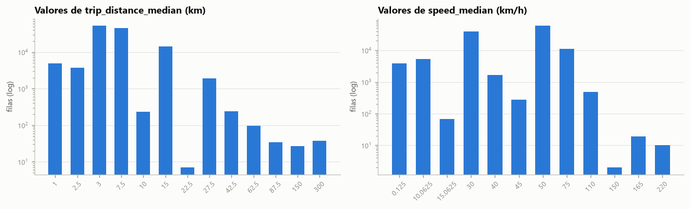

- `trip_distance_median` solo toma 13 valores: {1; 2,5; 3; 7,5; 10; 15; 22,5; 27,5; 42,5; 62,5; 87,5; 150; 300}.
  Son las **marcas de clase de dos histogramas diferentes** (uno con 1/3/7,5/15/27,5/42,5…, otro con 2,5/10/22,5…),
  seguramente de distintas generaciones de la unidad telemática.
- `speed_median` incluye el artefacto de coma flotante `220.00000000000003`.
- `trip_distance_mode` y `speed_mode` son **texto** con empates (`"2.5,7.5,15,30,60,100,180"`).

→ Por eso se recomienda usar las medias continuas en lugar de medianas y modas (§4.2).

### 7.5 Otros detalles

- **Fechas:** el rango va de 1987-01-14 a 2026-10-02, sin fechas futuras. Hay 33 vehículos anteriores a 2009 (clásicos, coherentes con la clase G, SL, etc.).
- **CP de 5 dígitos o con texto** (5 filas): corregidos (§6.3).
- **Mismo vehículo con distintas visitas al taller o distinta telemetría** según el cliente: no es un error, porque son métricas de la relación (§3).

---

## 8. Distribuciones de variables clave

### 8.1 Perfil demográfico del cliente (nivel cliente, n = 173.456)

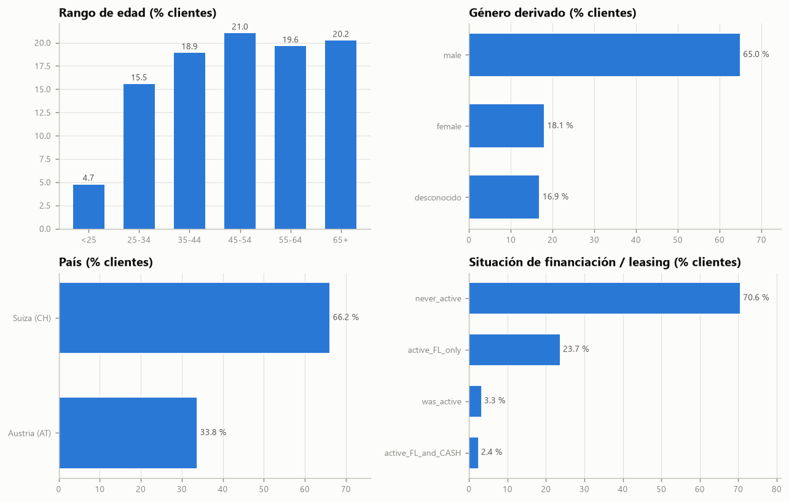

| Edad | % | | Género | % | | País | % |
|---|---:|---|---|---:|---|---|---:|
| <25 | 4,7 | | male | 65,0 | | CH | 66,2 |
| 25-34 | 15,5 | | female | 18,1 | | AT | 33,8 |
| 35-44 | 18,9 | | desconocido | 16,9 | | | |
| 45-54 | **21,0** | | | | | | |
| 55-64 | 19,6 | | | | | | |
| 65+ | 20,2 | | | | | | |

- La base es **madura**: el 61 % tiene 45 años o más y uno de cada cinco supera los 65. Los menores de 25 son marginales (4,7 %).
- Entre los clientes con género conocido, la proporción es de 78 % hombres y 22 % mujeres. La presencia femenina es mayor en las franjas de 25 a 54 años (≈ 20–23 %).

### 8.2 Relación con la marca

| Variable (nivel cliente) | Valor |
|---|---|
| Meses como cliente MB | mediana **36**, media 33,9, p25 = 18, p75 = 47 |
| Vehículos conectados actualmente | 0 → 10,4 % · **1 → 81,2 %** · 2 → 6,5 % · 3 o más → 1,9 % |
| Relaciones históricas | mediana 1, p90 2, p99 10 |
| Visitas en garantía (suma por cliente) | mediana 2, p90 7, p99 18 |
| Clientes multi-vehículo (≥ 2 actuales) | 8,4 % |
| Clientes B2B | 0,56 % |

**Financiación y leasing:**

| | never_active | active_FL_only | active_FL_and_CASH | was_active |
|---|---:|---:|---:|---:|
| **Total clientes** | **70,6 %** | 23,7 % | 2,4 % | 3,3 % |
| Austria | 82,4 % | 13,3 % | 2,3 % | 2,0 % |
| Suiza | 64,5 % | **29,1 %** | 2,5 % | 3,9 % |

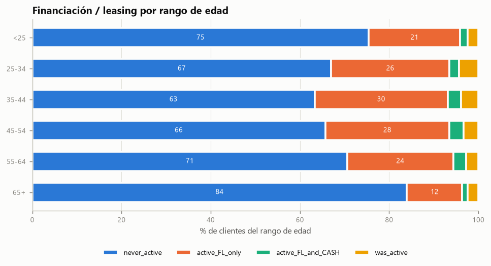

- El leasing es **más del doble de frecuente en Suiza** (29 % frente a 13 %).
- Sigue una curva en U invertida con la edad: alcanza el 33 % de leasing activo entre los 35 y los 44 años y cae al 13,6 % entre los mayores de 65 (84 % sin leasing).
- Los coches con leasing activo son más jóvenes (mediana de 3,4 años frente a 5,5 de los nunca financiados), algo coherente con contratos de 3–4 años.
  → Hay **oportunidad de renovación** al vencer los contratos.

**Consentimientos de comunicación:**

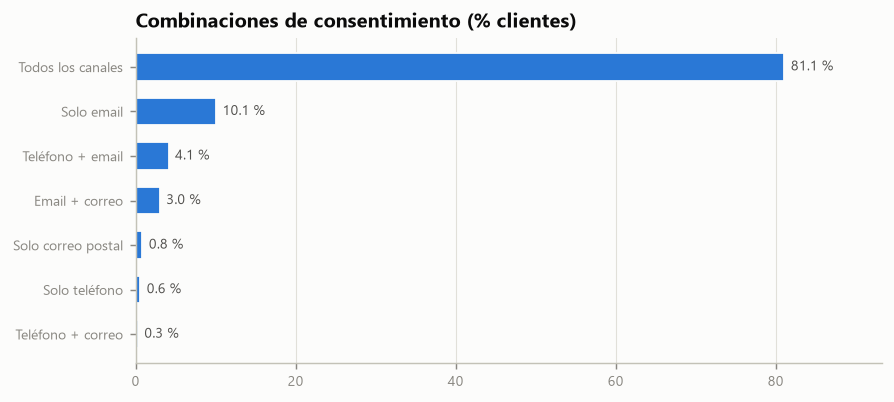

| Combinación (tel/email/correo) | % clientes |
|---|---:|
| Los tres canales | **81,1** |
| Solo email | 10,1 |
| Teléfono + email | 4,1 |
| Email + correo | 3,0 |
| Otros | 1,7 |

El email es casi universal (98,3 %), y teléfono y correo postal rondan el 85 %. No hay clientes sin ningún consentimiento.
Varían poco entre países, así que **discriminan poco** para segmentar. Son más útiles para elegir el canal de cada campaña
que como features de clustering.

### 8.3 Vehículo

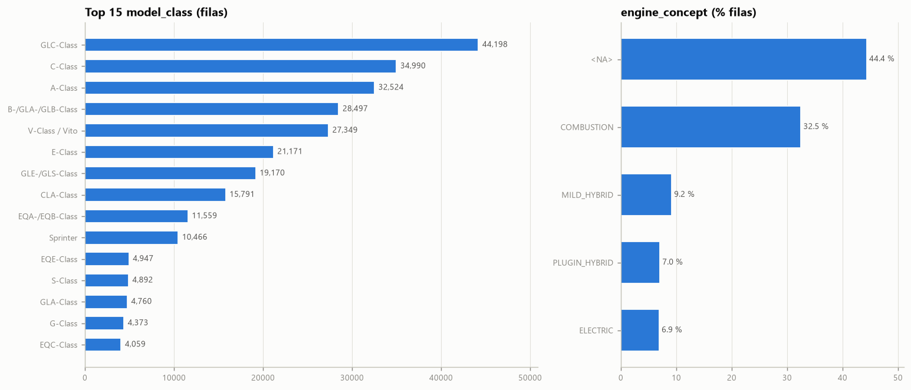

- **Modelos más frecuentes:** GLC (14,6 %), C (11,6 %), A (10,7 %), B/GLA/GLB (9,4 %), V-Class/Vito (9,0 %) y E (7,0 %).
  El cliente MB de esta base es sobre todo **SUV y berlina compacta o media**, con un 14 % de furgonetas.
- **Señales de gama** extraíbles de `vehicle_type`: AMG en el 12,8 % de las filas, 4MATIC (tracción total) en el 58,9 % y Maybach en el 0,14 %.
- **Antigüedad:** mediana de 4,7 años (p5 = 0,6; p95 = 10,7). Los combustión son mucho más antiguos (mediana de 6,4 años) que los electrificados (BEV 2,6; PHEV 2,4; MHEV 3,0).

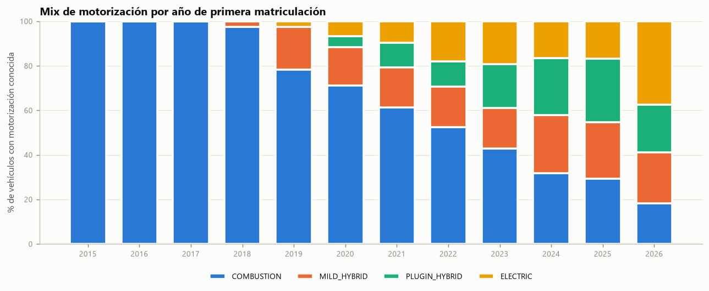

| Año de matriculación | Combustión | MHEV | PHEV | BEV |
|---|---:|---:|---:|---:|
| 2018 | 97,4 | 2,6 | 0,0 | 0,0 |
| 2020 | 71,2 | 17,0 | 5,0 | 6,7 |
| 2022 | 52,4 | 18,3 | 11,2 | 18,1 |
| 2024 | 31,7 | 26,2 | 25,6 | 16,5 |
| 2026 | **18,2** | 22,8 | 21,5 | **37,5** |

La transición es muy rápida: en 2026 solo 1 de cada 5 vehículos nuevos es de combustión pura.
**Austria está más electrificada** (BEV 16,7 %, PHEV 16,8 %) que Suiza (9,9 % y 10,2 %), que en cambio tiene más
microhíbridos (19,2 %). El 15,5 % de los clientes tiene algún BEV o PHEV entre sus vehículos actuales.

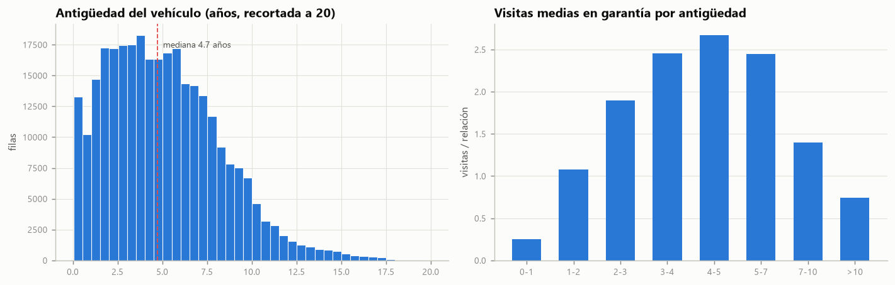

**Visitas al taller en garantía** según la antigüedad del vehículo: 0,25 (< 1 año) → 1,9 (2–3 años) → **2,67 (4–5 años)** →
1,39 (7–10) → 0,75 (> 10). Las visitas se acumulan durante la garantía y la extendida, y caen cuando el coche sale de
ese periodo o se vende. El 44 % de las relaciones tiene 0 visitas.

### 8.4 Socio-demografía de la zona

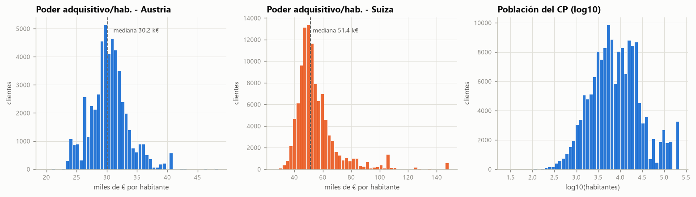

| Mediana (nivel cliente) | AT | CH |
|---|---:|---:|
| Poder adquisitivo por habitante | 30.178 € | **51.434 €** |
| Poder adquisitivo por hogar | 66.938 € | 116.082 € |
| Población del CP | 9.856 | 6.695 |

- El poder adquisitivo depende sobre todo del **país** (diferencia de unas 1,7 veces). Dentro de cada país la dispersión es
  moderada, con una cola de zonas muy ricas en CH (> 100 k€/hab.).
  → **Para el clustering conviene estandarizar el poder adquisitivo dentro de cada país** (z-score o percentil por
  país). Si no, el país dominará la variable.
- El poder adquisitivo apenas varía con la edad (mediana CH: 49,7 k€ en < 25 frente a 52,8 k€ en 65+).
- La población del CP es bimodal en escala logarítmica: hay pueblos (10³) y ciudades (10⁵). Puede servir como proxy **urbano/rural**.

### 8.5 Uso del vehículo (telemetría)

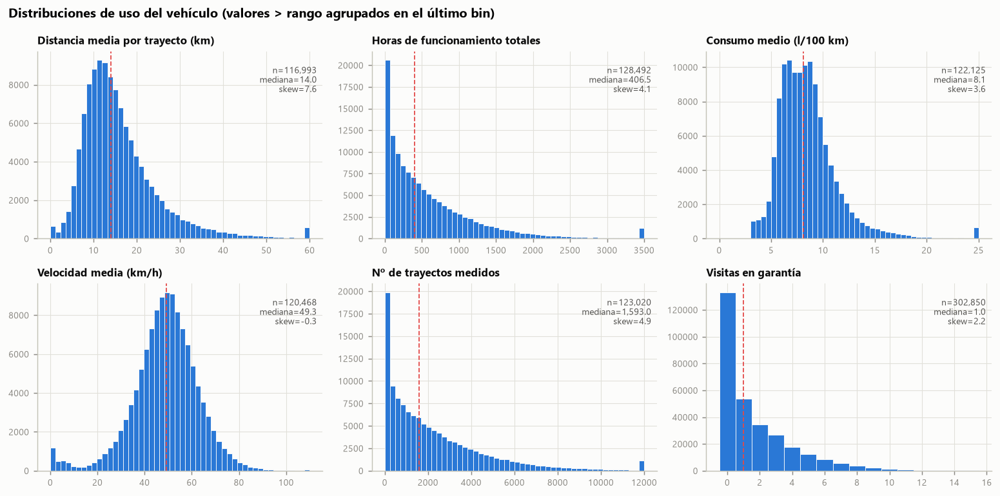

| Métrica | Mediana | p25–p75 | Lectura |
|---|---:|---|---|
| Distancia media por trayecto | 14,0 km | 10,2–19,5 | uso urbano o periurbano predominante |
| Horas de funcionamiento | 407 h | 137–856 | muy asimétrica (log recomendado) |
| Consumo medio | 8,1 l/100 km | 6,6–9,7 | |
| Velocidad media | 49,3 km/h | 41,2–57,3 | con un pico espurio cerca de 0 (§7.4) |
| Nº de trayectos | 1.593 | 518–3.321 | |

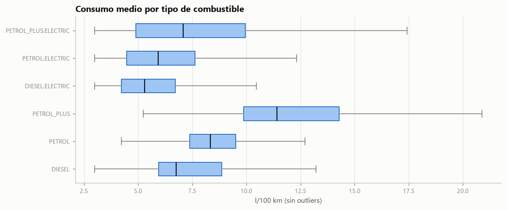

El consumo se ordena como cabría esperar: diésel (6,8) < gasolina (8,3) < **gasolina súper plus (11,4)**, que corresponde a
motores de altas prestaciones (AMG). Los PHEV consumen menos (5,3–7,1). Esto confirma que la telemetría, cuando
existe, es **físicamente coherente**.

---

## 9. Relaciones entre variables

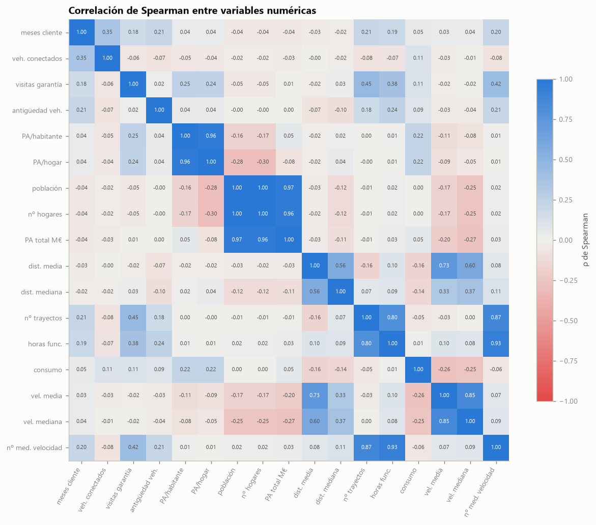

**Pares con |ρ| ≥ 0,7 (redundancia):**

| Par | ρ Spearman | Recomendación (no aplicada; ver §4.2) |
|---|---:|---|
| population ↔ number_of_households | 0,998 | descartar households |
| population ↔ purchasing_power_millions_eur | 0,967 | descartar PA total |
| PA/habitante ↔ PA/hogar | 0,956 | quedarse con PA/habitante |
| operating_hours_total ↔ speed_all_counter | 0,930 | descartar el contador |
| trip_distance_all_counter ↔ speed_all_counter | 0,870 | descartar los contadores |
| speed_average ↔ speed_median | 0,846 | quedarse con la media |
| trip_distance_all_counter ↔ operating_hours_total | 0,799 | quedarse con las horas |
| trip_distance_average ↔ speed_average | 0,733 | **mantener las dos** (trayecto largo = vía rápida), vigilar en el PCA |

**Relaciones moderadas con sentido de negocio:**

- `workshop_visits` ↔ `operating_hours` (0,38) y ↔ nº de trayectos (0,45): **más uso implica más taller**, lo que tiene sentido para segmentar planes de mantenimiento.
- `workshop_visits` ↔ PA/habitante (0,25): las zonas ricas generan más visitas (probablemente modelos de gama más alta y más servicios).
- `fuel_consumption` ↔ PA/habitante (0,22): en zonas ricas hay vehículos más potentes.
- `months_as_mb_customer` ↔ `currently_connected_vehicles` (0,35): la fidelidad se asocia a tener varios vehículos.
- `speed_average` ↔ population (−0,17): en zonas urbanas la velocidad media es más baja.

Fuera de los bloques redundantes, la mayoría de las variables son **casi independientes** (|ρ| < 0,3). Eso es
favorable para el clustering: cada dimensión (demografía, marca, vehículo, zona, uso) aporta información distinta.

---

## 10. Tratamiento de nulos (decisión del equipo, aplicado)

El tratamiento sigue lo acordado por el equipo en [`Descripcion_uso_de_datos`](../Descripcion_uso_de_datos).
Está implementado en `eda/eda_reto1.py` (sección 9) y genera `data/processed/relaciones_limpio.parquet`
(302.850 × 44, **0 nulos**) y `data/processed/clientes.parquet` (173.456 clientes).

### 10.1 Correspondencia letra → columna

El documento nombra las columnas por su letra al abrir el CSV en Excel (A = índice sin nombre).

| Letra | Columna | Nulos | Decisión |
|---|---|---:|---|
| A | `Unnamed: 0` | 0 | Quitar (ruido) |
| B | `client_id` | 0 | Quitar (ruido) · se guarda solo como clave |
| C | `vehicle_id` | 0 | Quitar (ruido) · se guarda solo como clave |
| D | `age_range` | 0 | Label encoding |
| E | `gender_derived` | 33.923 | Label encoding · nulos → nueva categoría |
| F | `model_series` | 0 | Label encoding |
| G | `vehicle_type` | 922 | Label encoding · nulos → moda de su `model_series` |
| H | `model_class` | 3.369 | Quitar (ruido) |
| I | `product_group` | 0 | Label encoding (umbrales) |
| J | `engine_concept` | 134.390 | Label encoding · nulos → moda |
| K | `country_code` | 0 | Label encoding |
| L | `fuel_type` | 178.745 | Label encoding · se saca a partir de J |
| M | `date_of_first_registration` | 4.182 | Label encoding (?) · **pendiente** |
| N | `is_current_vehicle` | 0 | One-hot · nulos → False |
| O | `role` | 0 | Label encoding · nulos → OWNER (moda) |
| P | `role_type` | 0 | One-hot · nulos → B2C (moda) |
| Q | `months_as_mb_customer` | 4 | Label encoding · nulos → 0.0 |
| R | `currently_connected_vehicles` | 0 | Label encoding · nulos → 1 (moda) |
| S | `finance_leasing_status` | 0 | Label encoding · nulos → never_active |
| T | `workshop_visits_warranty_goodwill` | 0 | Directo · nulos → moda |
| U, V, W | `consent_*` | 0 | One-hot · nulos → False |
| X | `purchasing_power_per_inhabitant_eur` | 19.087 | Directo · nulos → media del CP (o de la misma serie en el mismo CP) |
| Y | `purchasing_power_per_household_eur` | 19.087 | Directo · nulos → media del CP |
| Z | `population` | 19.014 | Directo · nulos → media del CP |
| AA | `zipcode` | 16.135 | Nulos → número aleatorio entre el mín. y el máx. del país |
| AB–AG | `trip_distance_average`, `_mode`, `_median`, `_all_counter`, `operating_hours_total`, `fuel_consumption_average` | 174.358–185.857 | Nulos → 0 |
| AH | `speed_average` | 182.382 | Nulos → velocidad moda de su `model_series` |
| AI | `speed_mode` | 181.159 | Nulos → moda de AH en su `model_series` |
| AJ | `speed_median` | 181.159 | Nulos → mediana de AH en su `model_series` |
| AK | `speed_all_counter` | 181.159 | Nulos → 1 |
| AL | `number_of_households` | 19.014 | Nulos → moda de su CP |
| AM | `purchasing_power_millions_eur` | 19.087 | Nulos → moda de su CP |

> Las codificaciones (label encoding y one-hot) son del reto 2. Aquí solo se aplica la parte de nulos y "quitar ruido".

### 10.2 Registro de lo aplicado

| Orden | Letra | Tratamiento | Valores afectados |
|---|---|---|---:|
| 0 | AA | *Limpieza previa:* CP normalizado (prefijos `A-`/`CH-` fuera; texto o 5 dígitos → nulo) | 5 |
| 0 | AB–AJ | *Limpieza previa:* valores imposibles → nulo (vel. < 1 km/h, horas = 0, contadores = 0; §7.4) | 15.529 |
| 0 | AB, AF, AG, AH | *Limpieza previa:* winsorización p1–p99 de los valores observados | ≈ 2.400 cada una |
| 0 | — | Flags antes de rellenar: `has_telemetry`, `socio_imputed`, `zip_imputed`, `engine_imputed`, `reg_date_imputed`, `months_is_36_spike` | — |
| 1 | E | nulo → `unknown` | 33.923 |
| 2 | G | nulo → `vehicle_type` más frecuente de su serie | 922 |
| 3 | J | nulo → moda (COMBUSTION) | 134.390 |
| 4 | L | nulo → `fuel_type` más frecuente para su `engine_concept` (COMBUSTION → DIESEL, MILD_HYBRID → PETROL, PLUGIN_HYBRID → DIESEL,ELECTRIC) | 178.745 |
| 5 | M | **provisional** (decisión pendiente): mediana de su `model_series` + flag | 4.182 |
| 6 | Q | nulo → 0.0 | 4 |
| 7 | N, O, P, R, S, T, U, V, W | reglas aplicadas (este extracto no tiene nulos en estas columnas) | 0 |
| 8 | AA | nulo → CP aleatorio en [1000, 9999] según país | 16.137 |
| 9 | X, Y, AM | nulo → valor de su CP / respaldo región / respaldo país | 4.580 / 12.521 / 1.986 |
| 9 | Z, AL | nulo → valor de su CP / respaldo región / respaldo país | 4.588 / 12.567 / 1.859 |
| 10 | AB, AC, AD | nulo → 0 | 185.857 |
| 10 | AE, AF, AG | nulo → 0 | 179.830 / 174.498 / 180.725 |
| 11 | AH | nulo → velocidad moda de su serie (redondeada a 1 km/h) / moda global si la serie no tiene datos | 145.603 / 37.668 |
| 11 | AI, AJ | nulo → moda / mediana de AH en su serie / global | 144.714 / 37.668 |
| 12 | AK | nulo → 1 | 181.159 |

**Resultado: 0 nulos en todas las columnas.**

### 10.3 Ajustes que hubo que hacer al aplicar el documento

| Punto | Qué pasa | Cómo se ha resuelto | Pendiente de validar por el equipo |
|---|---|---|---|
| **M "?"** | No hay decisión para la fecha de matriculación | Mediana de su `model_series` + flag `reg_date_imputed` (provisional) | Sí |
| **X, Y, Z, AL, AM "media/moda del CP"** | Los datos socio-demográficos son constantes por (país, CP) y ningún CP mezcla filas con y sin dato. La regla solo puede rellenar filas cuyo CP es aleatorio y coincide con uno real | Respaldo añadido: mediana de la región (2 primeros dígitos del CP) y del país | Sí |
| **AA CP aleatorio** | Solo el 31,6 % de los CP generados existe y el 28,4 % tiene datos socio-demográficos. El resto son zonas inventadas | Aplicado tal cual (semilla 42) + flag `zip_imputed` | Sí: alternativa más realista: muestrear entre los CP reales del país, ponderando por frecuencia |
| **CP "del país"** | Los CP de AT y CH comparten rango (1000–9999) y 993 códigos | La media o moda del CP se calcula sobre la clave (país, CP) | No |
| **AH sobre valores continuos** | La "moda" de una velocidad continua no está bien definida | Moda de los valores redondeados a 1 km/h; moda global para 37.668 filas de series sin ninguna medida | No |
| **B, C "quitar ruido"** | Sin `client_id` no se puede agregar por cliente (§3) | Se mantienen en el fichero solo como claves; no son features | No |

### 10.4 Impacto del relleno en las distribuciones

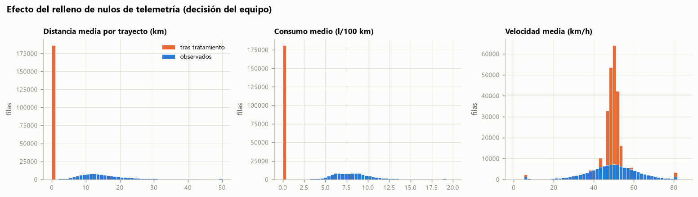

| Columna | Media observada | Media tras rellenar | Mediana observada | Mediana tras rellenar | % filas = 0 tras rellenar |
|---|---:|---:|---:|---:|---:|
| `trip_distance_average` | 15,9 | 6,2 | 14,0 | **0** | 61,4 |
| `operating_hours_total` | 605,7 | 256,7 | 407,3 | **0** | 57,6 |
| `fuel_consumption_average` | 8,5 | 3,4 | 8,1 | **0** | 59,7 |
| `speed_average` | 49,0 | 49,3 | 49,4 | 50,0 | 0 |
| `speed_all_counter` | 2,53 M | 1,02 M | 1,70 M | 1 | 0,4 |
| `purchasing_power_per_inhabitant_eur` | 46.481 | 46.117 | 46.166 | 45.666 | 0 |
| `population` | 19.665 | 18.774 | 7.132 | 6.610 | 0,06 |

**Lectura para el clustering:**

- **Telemetría a 0:** más de la mitad de las filas queda con distancia, horas y consumo iguales a 0. Para K-Means,
  "0 km por trayecto" está muy lejos de "14 km por trayecto", así que es **probable que aparezca un clúster de
  "clientes sin telemetría"** en lugar de un segmento de comportamiento real. Si el equipo lo acepta como segmento
  ("no conectados"), el 0 funciona como indicador. Si no, conviene modelar el uso solo sobre `has_telemetry = True`.
- **Velocidad por serie:** el 60 % de las filas recibe una velocidad típica de su serie (pico en 50 km/h). Además,
  la velocidad queda rellenada con un valor "normal" mientras distancia y consumo valen 0 en esas mismas filas:
  la combinación no describe ningún coche real.
- **Eléctricos:** el consumo 0 de los 20.944 BEV es coherente, pero se confunde con el 0 de "sin dato".
- **Motorización por moda:** sesgo del 76,9 % de combustión frente al 55,4 % real estimado (§6.2, fig. 18).
- **Socio-demografía:** el efecto es pequeño (la mediana del PA baja un 1 %), porque solo afecta al 6,3 % de las filas.

---

## 11. Hallazgos y conclusiones

### 11.1 ¿Cuáles son las principales características de los clientes?

1. **Base B2C, madura y masculina.** El 99,4 % son particulares; el 61 % tiene 45 años o más (el tramo 45–54 es el mayor, con un 21 %).
   Entre los de género conocido, el 78 % son hombres.
2. **Concentrada en Suiza** (66 %), con un poder adquisitivo de zona 1,7 veces mayor que el de Austria (51 k€ frente a 30 k€ por habitante).
3. **Monovehículo.** El 81 % tiene exactamente un vehículo conectado; solo el 8,4 % tiene dos o más. Además, un **10,4 % no tiene ningún vehículo actual** (ex-clientes o clientes dormidos).
4. **Relación de unos 3 años** con la marca conectada (mediana de 36 meses, influida por el pico artificial).
5. **Compra mayoritariamente sin leasing** (71 %). El leasing es cosa de Suiza (29 %) y de las edades de 25 a 54; los mayores de 65 casi no lo usan (13,6 %).
6. **Muy contactables:** el 81 % acepta teléfono, email y correo postal, y el 98 % acepta el email.
7. **Parque SUV y premium-compacto.** Predominan GLC, C, A y B/GLA/GLB. El 59 % lleva 4MATIC, el 13 % es AMG y el 14 % son furgonetas (V-Class, Vito, Sprinter).
8. **En plena electrificación.** Los BEV pasan del 2,5 % (2019) al 37,5 % (2026) de las matriculaciones. Austria va por delante en BEV y PHEV; Suiza lidera en microhíbridos.
   Los vehículos tienen una mediana de 4,7 años.
9. **Uso urbano o periurbano:** trayectos de unos 14 km a unos 49 km/h de media, con unas 400 h de uso acumulado.
   **Más uso implica más visitas al taller**, con un pico a los 4–5 años de antigüedad.

**Ejes de segmentación que sugiere el EDA:** (a) ciclo de vida con la marca (antigüedad como cliente, vehículos
actuales frente a históricos, leasing); (b) valor y gama (familia de modelo, AMG, poder adquisitivo relativo al país);
(c) transición energética (combustión, microhíbrido, PHEV o BEV); (d) intensidad de uso y necesidad de mantenimiento;
(e) edad y etapa vital.

### 11.2 ¿Qué problemas de calidad se han encontrado y cómo se han resuelto?

| Problema | Gravedad | Resolución (decisión del equipo) | Observación del EDA |
|---|---|---|---|
| Grano cliente–vehículo con clientes de hasta 561 filas | **Alta** | Vista agregada por cliente (`clientes.parquet`); `client_id` se guarda como clave | Decidir qué hacer con los 833 clientes con más de 20 relaciones |
| Telemetría ausente en el 52 % de las filas (MNAR) | **Alta** | Distancia, horas y consumo → 0; velocidad → moda o mediana de su serie; contador → 1; flag `has_telemetry` | Riesgo de un clúster artificial "sin telemetría" (§10.4) |
| `engine_concept` 44 % y `fuel_type` 59 % nulos | **Alta** | J → moda (COMBUSTION); L → valor más frecuente según J (DIESEL) | Sesga la electrificación (77 % frente a 55 % de combustión) y el diésel (71 % frente a 29 %). Las reglas validadas al 99–100 % son una alternativa (§6.2) |
| Socio-demografía nula (6,3 %), `population = 0`, CP con formato erróneo, CP repetidos entre países | Media | CP normalizado; CP nulo → aleatorio; X, Y, Z, AL, AM → valor del CP + respaldo región/país; flags | La regla "media del CP" solo cubre el 24 %; el 68 % de los CP aleatorios no existe (§10.3) |
| `gender_derived` inferido y con un 17 % de desconocidos no aleatorios | Media (ética) | Nueva categoría `unknown` | Usarlo solo para describir los segmentos |
| `vehicle_type` nulo (0,3 %) | Baja | Moda de su `model_series` | — |
| Fecha de matriculación nula (1,4 %) | Baja | Provisional: mediana de su serie + flag | **Pendiente de decisión (M?)** |
| `months_as_mb_customer` nulo (4 filas) / pico artificial en 36 meses | Baja / Media | Nulo → 0; flag `months_is_36_spike` | Discretización recomendada |
| Taxonomía `model_class` solapada + 3.369 nulos de series nuevas | Media | Columna eliminada (H); se usa `model_series` | Para el reto 4: traducir la serie a familia comercial |
| Valores imposibles en la telemetría (velocidad < 1 km/h, horas = 0, contadores a 0, topes 3/50/300) | Baja | → nulo (y después la regla del equipo) + winsorización p1–p99 | — |
| Columnas redundantes (socio-demografía derivada, contadores, medianas y modas discretizadas, `role_type`) | Media | Se mantienen | Recomendado excluirlas en el reto 2 (§4.2) |
| Índice `Unnamed: 0` exportado | Baja | Eliminado (A) | — |

**Puntos fuertes de la calidad del dato:** no hay duplicados; los atributos de cliente y de vehículo son 100 %
consistentes entre filas; `engine_concept` y `fuel_type` no se contradicen nunca; `currently_connected_vehicles`
cuadra con `is_current_vehicle` en el 99,998 % de los clientes; el cruce (país, CP) → socio-demografía es unívoco;
y la telemetría, cuando existe, es físicamente coherente (consumo por tipo de combustible).

---

## 12. Implicaciones para el reto 2 (feature engineering)

Recomendaciones que se derivan del EDA (se cerrarán en el reto 2):

1. **Modelar a nivel cliente** partiendo de `data/processed/clientes.parquet`, no sobre las filas.
2. **Decidir qué hacer con los clientes con muchas relaciones** (más de 20, 833 clientes): excluirlos del clustering B2C y tratarlos como un segmento "flota/profesional" aparte, o aplicar log o tope a `n_relaciones`.
3. **Revisar tres decisiones de nulos antes de entrenar** (§10.3–10.4): la moda en J/L (sesgo energético), el CP aleatorio en AA y el relleno con 0 de la telemetría (posible clúster artificial). Los flags `engine_imputed`, `zip_imputed` y `has_telemetry` permiten medir su efecto: por ejemplo, entrenar con y sin esas filas y comparar.
4. **Cerrar la decisión de M** (fecha de matriculación) y derivar `vehicle_age_years`, que ya está calculada.
5. **Features candidatas** (con su justificación en el EDA):
   - *Ciclo de vida:* `months_as_mb_customer` (en tramos, por el pico de 36), `currently_connected_vehicles`, `n_relaciones`, `tiene_vehiculo_actual`.
   - *Financiación:* `finance_leasing_status`.
   - *Demografía:* `age_range` (ordinal 0–5), `country_code` (binaria).
   - *Valor:* `purchasing_power_per_inhabitant_eur` **estandarizado dentro de cada país**; gama del modelo derivada de `model_series` o `vehicle_type` (AMG, segmento).
   - *Energía:* `share_electrificado_actual` y mix de `engine_concept`.
   - *Vehículo:* `edad_vehiculo_actual_media` (**feature derivada** sugerida en las especificaciones).
   - *Mantenimiento:* `visitas_taller_total` (log1p).
   - *Uso:* `trip_distance_average`, `operating_hours_total` (log), `speed_average`, junto con `has_telemetry`.
6. **Codificación:** el label encoding de nominales con muchas categorías (`vehicle_type`, 1.436 valores; `model_series`, 88; `zipcode`) crea un orden artificial que K-Means interpreta como distancia. Conviene limitarlo a las ordinales (`age_range`) y usar one-hot o agrupación para el resto.
7. **No usar como features:** identificadores, `gender_derived` (riesgo ético), los consentimientos (casi constantes: el 81 % acepta todo) y las redundancias de §4.2.
8. **Escalado:** `StandardScaler` o `RobustScaler` tras la transformación log de las variables asimétricas (asimetría > 2). K-Means es sensible a la escala y a los outliers.
9. **Encapsular** imputaciones y transformaciones en un `Pipeline` / `ColumnTransformer` de scikit-learn, reutilizando las reglas de la §10.

---

## 13. Anexo: ficheros generados

| Fichero | Contenido |
|---|---|
| `eda/eda_reto1.py` | Script reproducible: carga, diagnóstico, figuras, tablas y tratamiento |
| `eda/outputs/resultados.md` | Todas las tablas generadas (más detalle que este informe) |
| `eda/figures/fig01…fig18.png` | 18 figuras del informe |
| `data/processed/relaciones_limpio.parquet` | Dataset cliente–vehículo tratado según `Descripcion_uso_de_datos` (302.850 × 44, 0 nulos, con flags de imputación) |
| `data/processed/clientes.parquet` | Vista agregada por cliente (173.456 filas) como punto de partida del reto 2 |

| Figura | Tema |
|---|---|
| fig01 | Granularidad: filas por cliente y por vehículo |
| fig02 | % de nulos por columna |
| fig03 | Mapa de nulos (patrones por bloques) |
| fig04 | Disponibilidad de telemetría por rol, relación y año |
| fig05 | Perfil demográfico del cliente |
| fig06 | Relación con la marca (meses, vehículos conectados, visitas) |
| fig07 | Financiación por rango de edad |
| fig08 | Clase de modelo y motorización |
| fig09 | Mix de motorización por año de matriculación |
| fig10 | Antigüedad del vehículo y visitas en garantía |
| fig11 | Poder adquisitivo por país y población del CP |
| fig12 | Distribuciones de uso del vehículo |
| fig13 | Consumo por tipo de combustible |
| fig14 | Matriz de correlación de Spearman |
| fig15 | Medianas de telemetría discretizadas |
| fig16 | Combinaciones de consentimiento |
| fig17 | Efecto del relleno de nulos de telemetría |
| fig18 | engine_concept: moda (aplicada) frente a reglas validadas |
